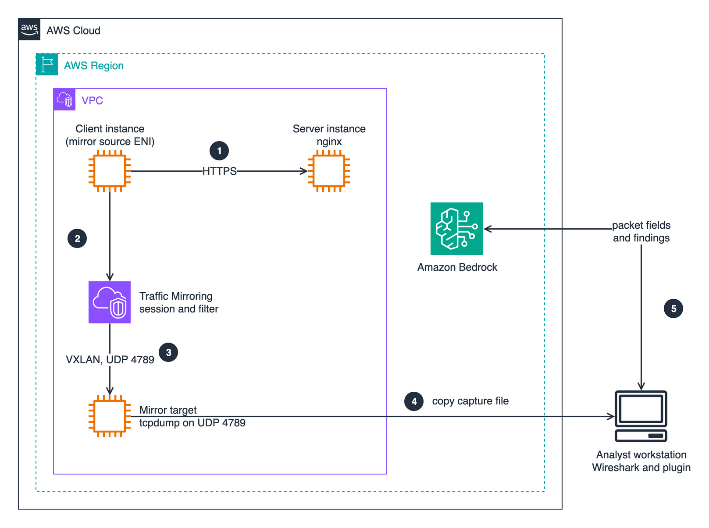

# Network Troubleshooting with Amazon Bedrock and Wireshark

A Wireshark plugin that sends a summary of captured packets to Amazon Bedrock and
displays an AI-generated network analysis in a Wireshark window.

It sends **dissected protocol metadata only**: protocol names, Wireshark's Info
column text, and structured fields such as TLS versions, DNS response codes and
TCP problem markers. Binary packet payload is never read or transmitted.

> **Note:** This is sample code, for non-production usage. Work with your
> security and legal teams to meet your organizational requirements before
> deployment.

## Architecture



1. The client connects to the server over HTTPS.
2. VPC Traffic Mirroring copies the packets from the client ENI that match the mirror filter.
3. The copies reach the mirror target as VXLAN on UDP 4789, and `tcpdump` writes them to a capture file.
4. The analyst copies the capture file to a workstation and opens it in Wireshark.
5. The plugin sends decoded packet fields to Amazon Bedrock and shows the findings in Wireshark.

The editable source is [`docs/architecture.drawio`](docs/architecture.drawio).
The plugin works on any capture file; Traffic Mirroring is one way to get one
from a running workload without installing anything on it.

## Features

- **Protocol-agnostic analysis**: works with any protocol Wireshark can dissect:
  TCP, UDP, ICMP, ARP, DNS, TLS, QUIC, DHCP, HTTP, SMB2, SSH, LDAP, Kerberos,
  SIP, MQTT and the rest. There is no protocol-specific collection logic.
- **Structured metadata**: 123 protocol fields are attached to each packet when
  the relevant dissector populates them, with numeric values decoded to text
  (`TLS 1.2 (771)`, `NXDOMAIN (3)`, `protocol_version (70)`).
- **Wireshark expert info**: retransmissions, zero window, duplicate ACKs,
  previous-segment-not-captured and similar findings are passed through with
  their severity.
- **Capture-integrity signal**: `tcp.completeness` tells the model whether it is
  seeing a whole conversation, so a real gap in the traffic can be told apart
  from a capture artifact.
- **Resilient extraction**: a field absent from your Wireshark build, an
  unreadable value or a misbehaving decoder degrades that one field: never the
  packet or the analysis.
- **Broad diagnostic prompt**: a 10-category checklist covering connectivity,
  name resolution, session setup, TLS negotiation, loss, timing, flow control,
  application errors, anomalies and expert info.
- **Configurable**: endpoint, API key, model and packet count via `config.json`.

## Installation

1. **Run the install script**:

   macOS/Linux:
   ```bash
   ./install_mac.sh
   ```

   Windows (PowerShell):
   ```powershell
   powershell -ExecutionPolicy Bypass -File install_windows.ps1
   ```

2. **Dependencies** (minimal):
   ```bash
   # Ensure curl is installed (used for HTTPS requests to Bedrock API)
   # macOS: curl is pre-installed
   # Linux: sudo apt-get install curl  (or yum install curl)
   # Windows 10+: curl is built-in
   ```

   > **Note**: JSON handling is bundled (`json.lua`): no external dependencies required.

3. **Set your API key** in the installed `config.json` (see Configuration).

4. **Restart Wireshark.** Lua plugins are loaded only at startup.

> **The installer never overwrites an existing `config.json`**, so your API key is
> safe across reinstalls. The flip side: if you change `model_id` in the repo copy,
> re-running the installer will *not* update an already-installed `config.json`.
> Edit the installed file directly.

## Configuration

Settings live in `config.json` next to the plugin, not in Wireshark preferences.
The plugin resolves the path relative to its own location, so `config.json` must
sit in the same directory as `amazon_bedrock.lua`:

| Platform | Location |
|---|---|
| macOS/Linux | `~/.local/lib/wireshark/plugins/config.json` |
| macOS (alt) | `~/Library/Application Support/Wireshark/plugins/config.json` |

```json
{
  "endpoint": "https://bedrock-runtime.us-east-1.amazonaws.com",
  "api_key": "",
  "model_id": "us.anthropic.claude-sonnet-5-5",
  "max_records": 500
}
```

### Configuration Options

- **endpoint**: Your Amazon Bedrock API endpoint
  - Default: `https://bedrock-runtime.us-east-1.amazonaws.com`
  - Format: `https://bedrock-runtime.<region>.amazonaws.com`

- **api_key**: Your Amazon Bedrock API key
  - Required for authentication. Paste the key between the quotes.

- **model_id**: The Bedrock model to use for analysis
  - Default: `us.anthropic.claude-sonnet-5-5`

  Recommended models, all invoked through the **Converse** API:

  | Model ID | Reasoning effort sent | Notes |
  |---|---|---|
  | `us.anthropic.claude-sonnet-5-5` *(default)* | `output_config.effort = medium` | Best balance of depth and latency |
  | `us.openai.gpt-6.1-sol` | `reasoning.effort = medium` | Comparable diagnosis; tends to rate the alert Warning rather than Critical |
  | `us.anthropic.claude-opus-5-5` | `output_config.effort = medium` | Slower, surfaces additional subtle correlations |
  | `us.moonshotai.kimi-k3` | `reasoning.effort = medium` | Fast (about 6 to 7 seconds); occasionally misnames the offered TLS version |

  On a 37-packet Traffic Mirroring capture of a TLS version mismatch, Sonnet
  5.5 and GPT-6.1 Sol both identified the fatal `protocol_version` alerts in
  streams 1 and 2, the missing `supported_versions` extension, and the working
  TLS 1.3 session, in roughly 12 to 18 seconds. Kimi K3 reached the same root
  cause in 6 to 7 seconds at medium or high effort, though one medium run
  described the second client as offering TLS 1.0 or 1.1. Without an effort
  setting it took about 45 seconds. DeepSeek V3.2 found the alerts but named the
  offered version as TLS 1.0, which is wrong. Latency varies run to run.

  The request body differs per model family, and the plugin picks the right
  shape from the model ID. Models that reject `temperature` are sent a medium
  reasoning effort instead. Every shape below was checked with a live Converse
  call on `bedrock-runtime` in us-east-1, using the latest model in each family.
  Use the `us.` cross-Region inference profile where one exists; the others are
  on-demand only and use the bare ID.

  | Family | Model ID | Request shape |
  |---|---|---|
  | Claude 5.5 | `us.anthropic.claude-sonnet-5-5`, `us.anthropic.claude-opus-5-5` | `maxTokens` 64000, `output_config.effort = medium` |
  | OpenAI GPT-6.1 | `us.openai.gpt-6.1-sol`, `us.openai.gpt-6.1-terra` | `maxTokens` 64000, `reasoning.effort = medium` |
  | Kimi K3 | `us.moonshotai.kimi-k3` | `maxTokens` 64000, `reasoning.effort = medium` |
  | Amazon Nova 2 | `us.amazon.nova-2-lite-v1:0` | `maxTokens` 64000, `temperature` 0.5 |
  | OpenAI gpt-oss | `openai.gpt-oss-120b-1:0` | `maxTokens` 32000, `temperature` 0.5 |
  | DeepSeek | `deepseek.v3.2` | `maxTokens` 32000, `temperature` 0.5 |
  | Llama | `us.meta.llama4-maverick-17b-instruct-v1:0` | `maxTokens` 8192, `temperature` 0.5 |
  | Mistral | `mistral.mistral-large-3-675b-instruct` | `maxTokens` 8192, `temperature` 0.5 |

  gpt-oss, DeepSeek R1 and Kimi K3 also return a reasoning block; the plugin
  shows only the final answer. Smaller and non-reasoning models tend to
  misdiagnose TLS version problems and are not recommended. Any unrecognised
  model ID, including older Claude and GPT versions, gets a conservative
  request shape and logs a warning.

  **OpenAI GPT-6.1 on Converse.** GPT-6.1 Sol and Terra are served on the
  `bedrock-runtime` Converse API through their `us.` or `global.` cross-Region
  inference profiles, with the same Bedrock API key. There is no in-Region
  model ID on `bedrock-runtime`; use `us.openai.gpt-6.1-sol` or
  `global.openai.gpt-6.1-sol`. See the
  [GPT-6.1 Sol model card](https://docs.aws.amazon.com/bedrock/latest/userguide/model-card-openai-gpt-6-1-sol.html).

- **max_records**: Number of packets to analyze
  - Default: 500
  - **Hard ceiling: 500.** A larger value in `config.json` is clamped, with a
    warning logged to the Wireshark console. See Limitations for why.

## AWS Authentication

Generate API keys following the [AWS Bedrock API Keys documentation](https://docs.aws.amazon.com/bedrock/latest/userguide/getting-started-api-keys.html)
and add the key to `config.json`.

## Usage

1. Open a capture file, or run a live capture, in Wireshark.
2. Go to **Tools → Analyze with Bedrock**.
3. The results window opens when Bedrock responds.

**Which packets are analyzed:** the first `max_records` packets of the capture,
in capture order.

Selecting rows in the packet list has **no effect**. Wireshark's Lua API exposes
no way to read the packet-list selection: its GUI module provides only
`register_menu`, `register_packet_menu`, `new_dialog`, `retap_packets`,
`copy_to_clipboard`, `open_capture_file`, `get_filter`, `set_filter`,
`apply_filter`, the color-filter slots and the reload/redissect calls. Packets are
collected by a frame tap as Wireshark dissects them.

To narrow the analysis, capture or export only the traffic of interest: for
example, `File → Export Specified Packets` after applying a display filter, then
open the exported file.

## What Gets Sent to Bedrock

A text prompt containing the analysis checklist, followed by one block per
packet:

```
Packet 24:
  Timestamp: 1785531242.6916
  Protocol: TLSv1.2
  Source: 10.0.192.154
  Destination: 10.0.52.67
  Length: 79 bytes
  Summary: Alert (Level: Fatal, Description: Protocol Version)
  Details: delta=0.000751 expert_sev=note (4194304) tcp_complete=complete WITH_DATA (31) ttl=64 tcp_stream=1 ack_rtt=0.000763 window=62464 tls_content=alert (21) tls_record=TLS 1.2 (771) tls_alert_lvl=fatal (2) tls_alert=protocol_version (70)
```

`Summary` is Wireshark's Info column. `Details` is omitted entirely for packets
whose dissectors populated none of the metadata fields: an ICMP packet carries
no TLS fields, and a UDP packet carries no TCP fields.

Multi-value fields (TLS extensions, cipher suites, DNS answers) are capped, with
overflow rendered as `+Nmore`, so a 31-suite ClientHello cannot bloat the request.

### Metadata fields by diagnostic question

123 fields, grouped by the question each one answers rather than by protocol
layer:

| Question | Fields |
|---|---|
| When, and what did Wireshark already notice? | frame time delta, expert message and severity, interface name |
| Am I seeing the whole conversation? | `tcp.completeness`: distinguishes a real gap from a capture artifact |
| What is the encapsulation? | VLAN id/priority, VXLAN VNI, GRE proto, Linux cooked packet type |
| Can the hosts reach each other at layer 2/3? | ARP opcode, sender/target IP, gratuitous, duplicate-address-detected |
| How many hops, fragmentation, congestion marking? | IPv4 TTL, IPv6 hop limit, IP id, DF/MF, fragment offset, DSCP, ECN, checksum status |
| Is the path broken, and how? | ICMP/ICMPv6 type and code, next-hop MTU (PMTUD black holes), response time |
| Is the transport healthy: loss, RTT, flow control? | TCP stream index, ack RTT, initial RTT, time delta, RTO, bytes in flight, window size, window scale factor, MSS, checksum; presence markers for retransmission, fast/spurious retransmission, out-of-order, lost segment, ack-lost-segment, duplicate ACK (+number), zero window, window full, keep-alive, reused ports; UDP stream, length, checksum |
| Did name resolution work, and was the answer right? | DNS response flag, rcode, query name and type, **A/AAAA/CNAME answers**, answer TTL, truncated, authoritative, recursion desired, query/answer counts, retransmission, response time |
| Did the client get an address? | DHCP message type, assigned address, server id |
| Did encryption negotiate, and if not, why? | TLS content type, record/offered/supported versions, handshake type, **extension list**, negotiated cipher suite, **JA4 fingerprint**, alert level and description, SNI, ALPN, certificate notBefore/notAfter |
| QUIC | version, long packet type, frame types |
| Did the application layer return an error? | HTTP method, URI, version, status code, reason phrase, host, redirect location, user agent, content length, response time |
| Application status codes that carry the root cause | SMB2 command/NT status/response time, NFS status, SSH version banner and message code, FTP/SMTP/SIP status, SIP method, LDAP result code, Kerberos error code, RADIUS code, SNMP error status, MQTT type and CONNACK, Modbus exception |
| Is the infrastructure itself changing? | BGP type, OSPF message, STP type, NTP mode |
| Wireless | 802.11 retry flag, signal strength (dBm) |

**Not sent:** binary packet payload. There are no raw byte ranges and no
payload-carrying fields (`data.data`, `http.file_data`, `tcp.payload`,
`tls.app_data`).

**Sent, and worth noting:** text identifiers that reveal what was accessed: DNS
query names, TLS SNI, HTTP host and request URI. Query strings in URIs can carry
tokens or session identifiers. Review this against your data-handling policy
before analyzing sensitive captures.

Why the metadata matters: Wireshark's Protocol column reports the TLS **record**
version, which cannot distinguish a TLS 1.2 offer from a TLS 1.0 offer: most
stacks send record version `0x0301` regardless. Both render as `TLSv1`. Without
`tls_offered`, the model can reach a confident but wrong conclusion about which
version a client proposed. `tls_ext` serves the same purpose for extensions: a
missing `supported_versions` becomes positive evidence rather than an inference
drawn from absent data.

## Analysis Output

The prompt asks the model to work through ten categories and report findings with
a severity (Critical / Warning / Informational), the affected endpoints, and the
specific packet numbers that evidence each one. It also asks it to classify the
likely root cause as Client-side, Server-side, Transit Network, Configuration or
Security Policy, to report protocol failures even when timing looks healthy, and
to state plainly when nothing is wrong rather than inventing a finding.

Treat the output as a first-pass diagnosis and confirm each finding against the
cited packets in Wireshark before acting on it. Text in the capture, such as DNS
names, TLS SNI and HTTP URIs, is controlled by whoever generated the traffic. The
prompt tells the model to treat that text as data, but a crafted capture can
still try to mislead the analysis.

## Limitations

- **No packet selection.** See Usage: Wireshark's Lua API does not expose it.
- **120-second request timeout** (`curl --max-time 120`). Large captures with a
  verbose model can exceed it; the analysis fails even though the request
  succeeded server-side.
- **30-second formatting timeout.** Packet formatting stops early beyond this,
  silently truncating the capture. It also uses string concatenation that scales
  quadratically, so it degrades on very large `max_records`.
- **Packet ceiling.** `max_records` is **clamped at 500** to bound the cost of
  each request and to stay inside the formatting and request timeouts. With the
  full metadata set a packet costs roughly 560 bytes of prompt. A larger value
  in `config.json` is capped and logged:

  ```
  [Bedrock Plugin] WARNING: max_records 900 exceeds the supported ceiling of 500 packets; capping at 500
  ```

- **curl 7.76 or later** is required (`--fail-with-body`). macOS, current Linux
  distributions and current Windows 10/11 builds include it.
- **Requires internet access** to the Bedrock endpoint, and is subject to your
  account's rate limits.

## Troubleshooting

The plugin logs to the Wireshark console (`View → Internals → Lua console`, or
launch `wireshark` from a terminal). Useful lines at startup:

```
[Bedrock Plugin] Column fields primed: protocol=true info=true
[Bedrock Plugin] Detail fields declared: 123/123
[Bedrock Plugin] Model: us.anthropic.claude-sonnet-5-5
```

If a field does not exist in your Wireshark build it is dropped at load and
named, without affecting anything else:

```
[Bedrock Plugin] Detail fields declared: 122/123
[Bedrock Plugin] Detail fields unavailable in this build: quic.frame_type
```

and at analysis time:

```
[Bedrock Plugin] Packets available from tap: 38
[Bedrock Plugin] max_records from config: 500
[Bedrock Plugin] Passing 38 packets for analysis
```

Errors are reported in the results window and in the console. A few things worth
remembering when something looks wrong:

- Open a capture file or start a live capture before running the analysis: the
  frame tap is empty until Wireshark dissects packets.
- `config.json` must sit beside `amazon_bedrock.lua` and be readable. The console
  prints the exact path it tried, and the installer will not overwrite an
  existing `config.json`.
- Restart Wireshark after changing the plugin. Lua plugins load only at startup.

## Development

### Checking Lua syntax

```bash
luac -p amazon_bedrock.lua json.lua       # syntax only
```

Syntax checking alone is not enough: it parses without executing. To verify the
plugin actually loads and to inspect the extracted fields:

```bash
tshark -r capture.pcap -X lua_script:amazon_bedrock.lua -q
```

## Security Considerations

- API keys are stored in `config.json`. Protect it: `chmod 600 config.json`.
- `config.json` is in `.gitignore`. Keep it that way.
- The request body and headers, including the API key, are passed to `curl`
  through private temporary files (owner-only on macOS/Linux, the user's
  `%TEMP%` on Windows) that are deleted as soon as the request completes. The key
  never appears on a command line or in the process list.
- Protocol metadata is sent to Amazon Bedrock, including DNS query names, TLS SNI
  and HTTP host/URI. Binary payload is not. Confirm this is acceptable for your
  captures and consistent with your organization's data-handling policy.
- Consider data sensitivity before analyzing captures containing PII.

## Uninstallation

macOS/Linux:
```bash
./uninstall_mac.sh
```

Windows (PowerShell):
```powershell
powershell -ExecutionPolicy Bypass -File uninstall_windows.ps1
```

This will:
- Remove the plugin files from Wireshark directories
- Clean up empty plugin directories
- Provide guidance for manually removing Lua dependencies if desired

## Clean up

The plugin creates no AWS resources. If you set up VPC Traffic Mirroring to
collect a capture, remove those resources when you're done, because a mirror
session keeps copying traffic and the mirror target instance keeps running until
you delete them. Delete them in this order: a filter or target can't be deleted
while a session still uses it.

```bash
# 1. Stop mirroring
aws ec2 delete-traffic-mirror-session --traffic-mirror-session-id <session-id>

# 2. Remove the filter and the target
aws ec2 delete-traffic-mirror-filter --traffic-mirror-filter-id <filter-id>
aws ec2 delete-traffic-mirror-target --traffic-mirror-target-id <target-id>

# 3. Terminate the instance that ran tcpdump, if you launched one for this
aws ec2 terminate-instances --instance-ids <instance-id>
```

Also:

- Delete the security group rule that allows UDP 4789 to the mirror target, or
  the security group itself if you created it for this.
- Delete capture files you no longer need. They contain your traffic metadata,
  and in some cases payload.
- Delete or rotate the Amazon Bedrock API key in `config.json` if you created it
  only for this, and remove the key from the file.

## Security

See [SECURITY](SECURITY.md) and [CONTRIBUTING](CONTRIBUTING.md#security-issue-notifications) for more information.

## License

This sample is licensed under the MIT-0 License. See the [LICENSE](LICENSE) file.

The bundled `json.lua` is copyright rxi and licensed under the MIT License. See
[THIRD-PARTY-LICENSES](THIRD-PARTY-LICENSES).
